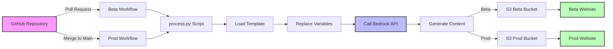

# Bedrock Content Pipeline

Automated content generation using Amazon Bedrock (Claude 3 Sonnet) with GitHub Actions CI/CD.

## How It Works



## Quick Setup

### 1. AWS Setup

1. **Enable Bedrock**: AWS Console → Bedrock → Model access → Request "Claude 3 Sonnet"
2. **Create S3 Buckets**: 
   ```bash
   aws s3 mb s3://my-beta-bucket
   aws s3 mb s3://my-prod-bucket
   ```
3. **Enable Static Hosting**: S3 Console → Each bucket → Properties → Static website hosting → Enable
4. **Make Public**: Permissions → Block public access OFF → Add bucket policy:
   ```json
   {
     "Version": "2012-10-17",
     "Statement": [{
       "Sid": "PublicRead",
       "Effect": "Allow",
       "Principal": "*",
       "Action": "s3:GetObject",
       "Resource": "arn:aws:s3:::BUCKET-NAME/*"
     }]
   }
   ```
5. **Create IAM User**: `github-actions` with policy for Bedrock + S3 access → Save access keys

### 2. GitHub Setup

Add secrets in Settings → Secrets → Actions:
- `AWS_ACCESS_KEY_ID`
- `AWS_SECRET_ACCESS_KEY`
- `AWS_REGION` (e.g., us-east-1)
- `S3_BUCKET_BETA` (your beta bucket name)
- `S3_BUCKET_PROD` (your prod bucket name)

### 3. Project Files

```
├── .github/workflows/
│   ├── beta.yml         # Runs on PR
│   └── prod.yml         # Runs on merge to main
├── prompts/
│   └── welcome.json     # Configuration
├── templates/
│   └── welcome.txt      # Prompt template
├── process.py           # Main script
└── requirements.txt     # boto3==1.34.0
```

## Creating Content

### Template (`templates/newsletter.txt`)
```
Write a newsletter about {topic} for {month}.
Include: {highlights}
Format as HTML.
```

### Configuration (`prompts/newsletter.json`)
```json
{
  "template": "newsletter.txt",
  "output_format": "html",
  "max_tokens": 2000,
  "variables": {
    "topic": "AI in Education",
    "month": "January",
    "highlights": "3 new courses launched",
    "output_name": "newsletter_jan"
  }
}
```

### Multiple Outputs
```json
{
  "template": "welcome.txt",
  "variable_sets": [
    {"name": "Alice", "course": "Python", "output_name": "welcome_alice"},
    {"name": "Bob", "course": "Data Science", "output_name": "welcome_bob"}
  ]
}
```

## Deployment

### Beta (Pull Request)
1. Create branch: `git checkout -b feature`
2. Make changes and push
3. Create PR on GitHub
4. Beta workflow runs automatically
5. View at: `https://my-beta-bucket.s3-website-region.amazonaws.com/beta/outputs/`

### Production (Merge)
1. Merge PR to main
2. Prod workflow runs automatically
3. View at: `https://my-prod-bucket.s3-website-region.amazonaws.com/prod/outputs/`

## Viewing Content

- **Beta**: `https://[BETA-BUCKET].s3-website-[REGION].amazonaws.com/beta/outputs/[filename].html`
- **Prod**: `https://[PROD-BUCKET].s3-website-[REGION].amazonaws.com/prod/outputs/[filename].html`

Files are also visible in S3 Console under `beta/outputs/` or `prod/outputs/` folders.

## Cost

- ~$0.01 per generation (Claude 3 Sonnet: $0.003/1K input + $0.015/1K output tokens)
- S3 storage: Negligible for HTML files
- No minimum fees or commitments

## Troubleshooting

| Issue | Solution |
|-------|----------|
| Workflow doesn't run | Check branch names in workflows match your setup |
| Access Denied | Verify IAM policy has correct bucket names |
| No files in S3 | Check GitHub Actions logs for errors |
| Can't view website | Ensure static hosting enabled + bucket is public |

## Local Testing

```bash
export AWS_REGION=us-east-1
export S3_BUCKET_BETA=my-beta-bucket
python process.py beta
```
